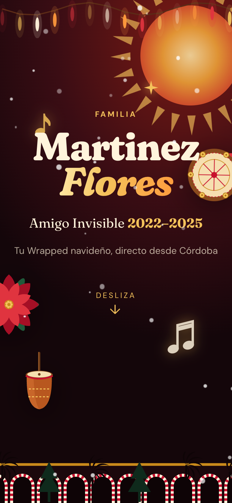
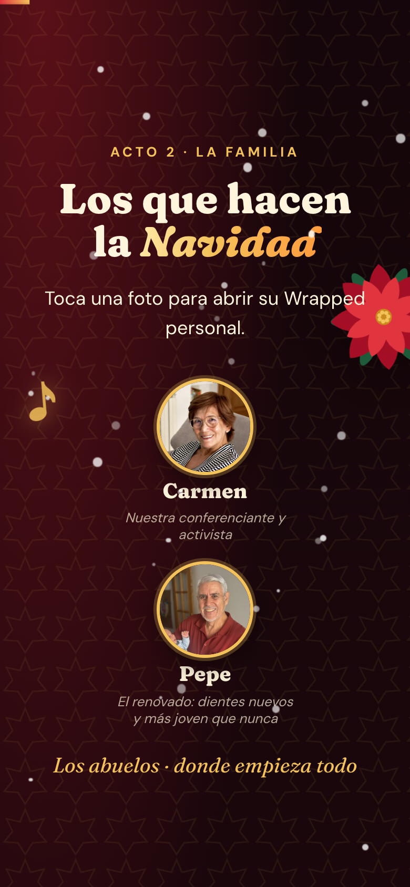
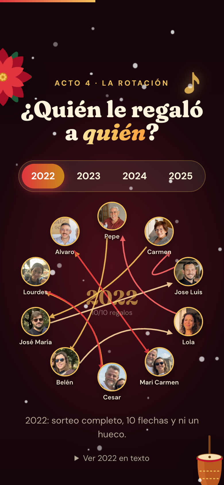
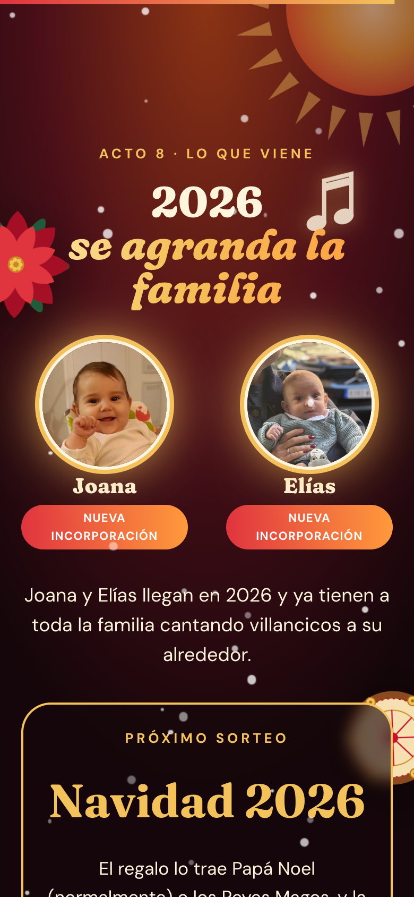

# 🎁 Amigo Invisible · Familia Martinez Flores

> Cada Navidad, en Córdoba, entre villancicos, zambomba, panderetas y palmas, alguien guarda un secreto: **a quién le toca regalar**. Esta web cuenta esa historia como si fuera un *Spotify Wrapped*… pero de los regalos de la familia.

🌐 **Web publicada:** https://amigo-invisible-martinez-flores.vercel.app (acceso protegido con Vercel Authentication: hay fotos de los peques).

## ✨ ¿Qué es esto?

Una página para recorrer **haciendo scroll** las Navidades de 2022 a 2025: quién regaló a quién, las casualidades, los récords y hasta el misterio de los regalos que nadie apuntó. Todo con nieve, luces, flores de pascua, panderetas, zambomba y un poquito de sol andaluz, porque aquí la Navidad también se canta.

El regalo lo trae Papá Noel (casi siempre) o los Reyes Magos. El amigo invisible, en cambio, lo traemos nosotros.

## 🎄 Qué vas a encontrar

| Acto | De qué va |
|---|---|
| 1. Portada | Familia Martinez Flores · Amigo Invisible 2022–2025 |
| 2. La familia | Los abuelos y las cuatro ramas. Toca una foto y se abre **tu Wrapped personal** |
| 3. Los números | Sorteos, regalos y participantes, con contadores animados |
| 4. La rotación | Flechas que enseñan quién regaló a quién cada año |
| 5. Récords | Repeticiones, rachas, el más regalado… con humor |
| 6. Cruces | Cómo viajan los regalos entre las familias |
| 7. El misterio | Los regalos que se perdieron del registro (¿Papá Noel?) |
| 8. 2026 | Joana y Elías, las nuevas incorporaciones, y el próximo sorteo |

  
  
  

## 👨‍👩‍👧‍👦 La familia

Los abuelos **Carmen** y **Pepe**, y cuatro ramas: Jose Luis y Lola, Mari Carmen y Cesar, Belén y José María, Lourdes y Alvaro (con sus peques). Los niños no entran en el sorteo: juegan los 10 mayores.

## 🚀 Verlo en 3 pasos

Necesitas [Node.js](https://nodejs.org) instalado.

1. **Instalar**: `npm install`
2. **Arrancar**: `SITE_PASSWORD=tu-contraseña npm run build && SITE_PASSWORD=tu-contraseña npm start`
3. **Abrir**: en el ordenador, <http://localhost:4173>. En el móvil (misma wifi), `http://TU-IP-LOCAL:4173` (en Mac: `ipconfig getifaddr en0`).

## 🧑‍🎄 Añadir un sorteo nuevo o cambiar una foto

Todo sale de dos archivos en `src/data/`; las estadísticas se recalculan solas al hacer `npm run build`.

- **Nuevo año**: en `sorteos.json`, añade `"2026": <id del que recibe>` en los `regalos` de cada persona. Si no se sabe, pon `null` (dato perdido, no “no participó”).
- **Nueva persona o apodo**: edita `familia.json`.
- **Cambiar una foto**: sustituye `public/people/<id>.webp` por otra cuadrada (800×800).

## 🛠️ Para los técnicos

Next.js (App Router) + TypeScript + Framer Motion, CSS plano, servidor Next.js con un proxy que protege todo el sitio con contraseña. Estadísticas en `src/lib/stats.ts`, escenas en `src/components/`. Respeta `prefers-reduced-motion`. `npm run dev` para desarrollo y `npm run lint` para revisar. `INFORME-DATOS.md` valida los sorteos y `screenshots/` guarda capturas de cada acto.

¡Felices fiestas! 🎶🔔

## 🔒 Contraseña de acceso

Toda la web (páginas y fotos) está cerrada: solo entra quien conoce la contraseña. Se define en la variable de entorno `SITE_PASSWORD` (ver `.env.example`; nunca se sube al repo). Sin ella, nadie puede entrar. Al acertar, se guarda una cookie firmada durante 30 días.

- En local: copia `.env.example` a `.env.local` y escribe la contraseña.
- En Vercel: `npx vercel env add SITE_PASSWORD production` y luego `npx vercel deploy --prod` (o Project Settings → Environment Variables y redeploy).
